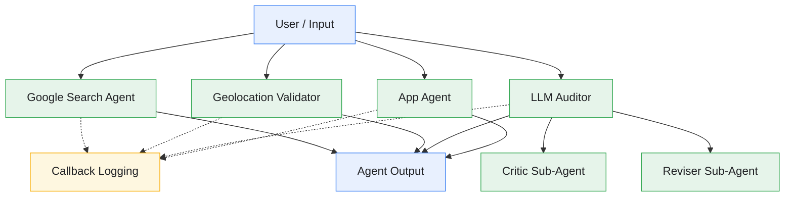

# 🔍 Search Agent 🤖

https://github.com/user-attachments/assets/ec157bc1-c3b0-434d-ac21-bb212f929643

> 🎥 Watch **Search Agent** in action! 🔎

> [!CAUTION]
> The Cloud Run deployment is currently unavailable because the Google Cloud project has exhausted its available credits. The project was previously deployed and tested successfully on Google Cloud Run.

---

## Table of Contents

- [Introduction](#introduction)
- [Architecture Diagram](#architecture-diagram)
- [Project Structure](#project-structure)
- [Features](#features)
- [Tech Stack](#tech-stack)
- [Application Workflow](#application-workflow)
- [Screenshots](#screenshots)
- [Agent Behavior and Capabilities](#agent-behavior-and-capabilities)
- [AI-Assisted Development](#ai-assisted-development)
- [Google Skills Challenge Lab Reference](#google-skills-challenge-lab-reference)
- [Future Enhancements](#future-enhancements)
- [Resources](#resources)
- [Disclaimer](#disclaimer)
- [Contributing](#contributing)
- [License](#license)
- [Author](#author)

---

## Introduction

**Search Agent** is a Python-based AI agent project developed as part of my hands-on learning with Google's **Agent Development Kit (ADK)**.

The project explores how to build AI agents using Google ADK, integrate search capabilities and Python tools, validate information, and evaluate AI-generated responses through specialized agent components.

The repository includes multiple agent implementations, each serving a distinct purpose. These include a Google Search agent, a geolocation validator, an LLM auditing agent with dedicated critic and reviser sub-agents, and a separate application agent. The project also includes callback logging functionality to support agent-related logging and monitoring.

The project demonstrates practical concepts in AI agent development, including tool integration, specialized agent design, information validation, response auditing, and multi-agent architectures.

This repository documents my implementation and learning with Google ADK, including the agent structure, supporting modules, dependencies, and related learning resources.

The source code is associated with the following Google Skills learning resources:

---

## Architecture Diagram

The following diagram illustrates a **conceptual view** of the agent components present in the repository. It shows their general roles without claiming that every component is connected in a single execution workflow.



> [!NOTE]
> This diagram is a conceptual overview of the repository's components, not a verified runtime execution trace. The exact execution paths, tool calls, model configuration, and relationships between agents depend on the implemented code and configuration.

### Architecture Overview

1. **Google Search Agent**
   - Contains the Google Search agent implementation.
   - Provides the starting point for exploring search-oriented agent behavior and information retrieval.

2. **Geolocation Validator**
   - Contains the geolocation validation agent.
   - Provides a dedicated component for location-related validation logic.

3. **LLM Auditor**
   - Contains the auditing agent.
   - Includes specialized critic and reviser sub-agents for exploring response evaluation and revision workflows.

4. **Critic Sub-Agent**
   - Contains the critic agent implementation and its associated prompt.
   - Provides a dedicated component for exploring response criticism and evaluation.

5. **Reviser Sub-Agent**
   - Contains the reviser agent implementation and its associated prompt.
   - Provides a dedicated component for exploring response revision.

6. **App Agent**
   - Contains a separate agent implementation.
   - Provides another entry point for exploring Google ADK agent development.

7. **Callback Logging**
   - Contains callback-related logging functionality.
   - Supports investigation and troubleshooting of agent activity where the implemented callbacks are used.

---

## Project Structure

The repository organizes the source code into separate agent modules and supporting files.

```text
search-agent/
├── adk_agents/
│   ├── app_agent/
│   │   ├── __init__.py
│   │   └── agent.py
│   │
│   ├── geo_validator/
│   │   ├── __init__.py
│   │   └── agent.py
│   │
│   ├── llm_auditor/
│   │   ├── __init__.py
│   │   ├── agent.py
│   │   └── sub_agents/
│   │       ├── __init__.py
│   │       ├── critic/
│   │       │   ├── __init__.py
│   │       │   ├── agent.py
│   │       │   └── prompt.py
│   │       └── reviser/
│   │           ├── __init__.py
│   │           ├── agent.py
│   │           └── prompt.py
│   │
│   ├── my_google_search_agent/
│   │   ├── __init__.py
│   │   └── agent.py
│   │
│   ├── callback_logging.py
│   └── requirements.txt
│
├── .gitignore
├── CODE_OF_CONDUCT.md
├── CONTRIBUTING.md
├── LICENSE
├── README.md
└── SECURITY.md
```

> [!NOTE]
> This tree represents the main source files identified in the project. Additional files or configuration may exist in individual directories. Refer to the repository for the complete structure.

### Key Components

- **`adk_agents/`** — Contains the Python-based agent implementations and supporting modules.
- **`app_agent/`** — Contains the separate app agent implementation.
- **`geo_validator/`** — Contains the geolocation validation agent.
- **`llm_auditor/`** — Contains the LLM auditing agent and its specialized sub-agents.
- **`llm_auditor/sub_agents/critic/`** — Contains the critic agent and its prompt definition.
- **`llm_auditor/sub_agents/reviser/`** — Contains the reviser agent and its prompt definition.
- **`my_google_search_agent/`** — Contains the Google Search agent implementation.
- **`callback_logging.py`** — Contains callback-related logging code.
- **`requirements.txt`** — Lists the Python dependencies for the agent project.
- **`.gitignore`** — Excludes configured local, generated, and sensitive files from version control.
- **`CONTRIBUTING.md`, `CODE_OF_CONDUCT.md`, and `SECURITY.md`** — Describe contribution, community conduct, and security-reporting guidelines.

---

## Features

- **Google ADK Integration:** Explores the development of AI agents using Google's Agent Development Kit.
- **Google Search Agent:** Includes a dedicated agent implementation for search-oriented workflows.
- **Modular Agent Structure:** Separates agent implementations into distinct directories.
- **Geolocation Validation:** Includes a specialized geolocation validator.
- **LLM Auditing:** Includes an agent dedicated to auditing language-model outputs.
- **Critic and Reviser Sub-Agents:** Separates response criticism and revision into dedicated components.
- **Prompt Organization:** Maintains separate prompt files for the critic and reviser agents.
- **Callback Logging:** Includes supporting code for callback-related logging.
- **Python-Based Development:** Uses Python for agent implementations and supporting functionality.
- **Dependency Management:** Includes a requirements file for managing project dependencies.
- **Extensible Architecture:** Provides a foundation for experimenting with additional agents, tools, validation rules, and evaluation workflows.
- **Open-Source Collaboration:** Includes contribution guidelines, a Code of Conduct, a security policy, and an open-source license.

> [!NOTE]
> The actual capabilities and execution behavior of each agent depend on its implementation, configuration, dependencies, and the availability of any required external services.

---

## Tech Stack

| Technology | Purpose |
|---|---|
| **Python** | Primary programming language |
| **Google Agent Development Kit (ADK)** | Agent development and orchestration framework |
| **Google Search** | Search-oriented agent integration |
| **Large Language Models (LLMs)** | Language-model-based agent behavior and response generation, where configured |
| **Python Modules** | Organization of agent implementations and supporting code |
| **Prompt Files** | Organization of critic and reviser prompts |
| **Callback Logging** | Supporting agent observability and troubleshooting |
| **Git** | Version control |
| **GitHub** | Source code hosting, collaboration, and documentation |

> [!NOTE]
> The table describes the technologies and concepts reflected in the project. The exact model provider, authentication method, and external service configuration should be verified against the source code before running the agents.

---

## Application Workflow

**Search Agent** is organized around distinct agent implementations. The workflow for a particular request depends on which agent is used and how it is configured.

### 1️⃣ Agent Selection

- Identify the agent implementation appropriate for the task.
- Review its `agent.py` file and associated instructions.
- Determine the dependencies and configuration it requires.

### 2️⃣ Request Processing

- Provide an input to the selected agent through its supported interface.
- The agent interprets the request according to its instructions and configured capabilities.
- Where implemented, the agent may use tools or delegate work to specialized components.

### 3️⃣ Search-Oriented Processing

- The Google Search agent provides the starting point for search-related experimentation.
- Search behavior depends on the agent implementation and configured tools.
- Retrieved information should be distinguished from assumptions or unsupported claims.

### 4️⃣ Geolocation Validation

- The geolocation validator provides a separate component for location-related validation.
- Its behavior depends on the validation logic and instructions implemented in the agent.
- Inputs and validation outcomes should be checked against the intended rules.

### 5️⃣ LLM Auditing

- The LLM auditor provides a component for exploring response auditing.
- The repository includes separate critic and reviser agent implementations.
- Their individual roles and coordination should be determined from the relevant agent code and prompts.

### 6️⃣ Callback Logging

- Callback-related code can support investigation of agent activity where callbacks are registered.
- Logs can help with troubleshooting and understanding execution behavior.
- Logging should avoid exposing API keys, credentials, tokens, or other sensitive information.

### 7️⃣ Review and Improvement

- Review agent outputs against the available evidence and expected behavior.
- Test representative inputs, including incomplete or invalid cases where relevant.
- Refine agent instructions, prompts, validation logic, and tool integration as needed.

---

## Screenshots

This section will showcase the **Search Agent** interface, example conversations, paint-selection workflow, and deployment.

### Paint Agent Interface


---

## Agent Behavior and Capabilities

### Google Search Agent

The `my_google_search_agent/` directory contains the dedicated Google Search agent implementation.

Areas to explore include:

- Agent instructions and descriptions.
- Search-related tool configuration.
- Handling of search requests.
- Interpretation of retrieved information.
- Response quality and relevance.
- Handling of incomplete results and errors.

The precise capabilities depend on the code and configuration included in the repository.

### Geolocation Validator

The `geo_validator/` directory contains the geolocation validation agent.

Areas to explore include:

- Location-related input handling.
- Validation rules and assumptions.
- Handling of incomplete or invalid information.
- Error handling and response clarity.
- Testing against representative inputs.

Validation results should be interpreted according to the rules actually implemented by the agent.

### LLM Auditor

The `llm_auditor/` directory contains the LLM auditing agent.

Its sub-agent structure includes:

- **Critic:** The `critic/` directory contains the critic agent implementation and prompt.
- **Reviser:** The `reviser/` directory contains the reviser agent implementation and prompt.

This structure provides an opportunity to explore how language-model-based components can be separated by responsibility.

AI-generated critiques and revisions should be reviewed rather than treated as guaranteed proof of correctness.

### App Agent

The `app_agent/` directory contains a separate agent implementation.

It provides another component for studying agent instructions, configuration, tool integration, and behavior within the Google ADK ecosystem.

### Callback Logging

The `callback_logging.py` module provides callback-related logging code.

Logging can support debugging and investigation of agent activity when the relevant callbacks are integrated into an execution workflow.

Logs should be useful for troubleshooting while avoiding the disclosure of sensitive data.

---

## AI-Assisted Development

AI tools can support the development and exploration of AI agents by helping explain unfamiliar code, investigate implementation issues, understand agent architectures, and improve technical documentation.

During the development and learning process for **Search Agent**, AI assistance may be used to support activities such as:

- Understanding Google ADK concepts and agent implementation patterns.
- Exploring the structure and responsibilities of the Google Search agent, geolocation validator, and application agent.
- Understanding multi-agent architectures and the roles of the LLM auditor, critic, and reviser sub-agents.
- Investigating Python code, dependencies, configuration, and potential integration issues.
- Reviewing callback-related logging and agent workflows.
- Improving project documentation, code readability, and repository presentation.

AI-generated suggestions and code should be reviewed critically, verified against the actual implementation, and tested before being adopted. AI assistance is intended to support learning and development, not replace independent verification of the project's behavior, dependencies, or configuration.

---

## Google Skills Challenge Lab Reference

This project was developed after completing the following Google Skills learning resources.

### Course

**Engineer AI Agents with Agent Development Kit (ADK)**

[Open the Google Skills course](https://www.skills.google/course_templates/1596)

### Challenge Lab

**Engineer AI Agents with Agent Development Kit (ADK): Challenge Lab**

[Open the Google Skills lab](https://www.skills.google/course_templates/1596/labs/647534)

### Learning Context

The repository serves as a personal source-code project associated with this learning experience.

It provides a place to explore and document:

- Google Agent Development Kit (ADK).
- Python-based agent development.
- Search-oriented agent implementations.
- Agent organization and modularity.
- Geolocation validation.
- Language-model auditing.
- Critic and reviser sub-agent components.
- Prompt organization.
- Callback-related logging.
- Further experimentation with AI agent workflows.

For the official learning objectives, instructions, and any environment-specific setup requirements, refer to the Google Skills course and lab pages linked above.

---

## Future Enhancements

The following ideas could be considered for future versions of Search Agent:

- **Improved Search Handling:** Enhance search-query construction, result relevance, and response grounding.
- **Agent Evaluation:** Add repeatable test cases for agent behavior and response quality.
- **Enhanced Geolocation Validation:** Expand validation tests for incomplete, ambiguous, and invalid inputs.
- **Improved LLM Auditing:** Develop clearer evaluation criteria and more systematic auditing workflows.
- **Critic and Reviser Evaluation:** Test how revisions address issues identified by the critic.
- **Prompt Improvements:** Refine prompts to make agent responsibilities and expected outputs clearer.
- **Error Handling:** Improve handling of unavailable services, malformed inputs, and unexpected tool responses.
- **Observability:** Improve callback logging and troubleshooting while protecting sensitive information.
- **Automated Testing:** Add tests for agent modules, validation rules, and supported workflows.
- **Documentation:** Add setup instructions, architecture details, usage examples, and troubleshooting guidance.
- **Configuration Management:** Document required environment variables and service configuration without exposing secrets.
- **Agent Integration:** Explore additional workflows between the existing components where appropriate.

> [!IMPORTANT]
> These are potential improvements, not claims that the features are already implemented. Any future integration should be verified against the existing architecture and tested before being documented as available functionality.

---

## Resources

[](https://google.github.io/adk-docs/)
[](https://cloud.google.com/docs)
[](https://ai.google.dev/gemini-api/docs)
[](https://docs.python.org/3/)
[](https://git-scm.com/doc)
[](https://docs.github.com/)

---

## Disclaimer

**Search Agent** is a learning and demonstration project associated with Google Skills training.

The project uses or explores third-party technologies and services, including Google Agent Development Kit (ADK), Google Search, and language-model-based agent development. The availability, functionality, usage limits, pricing, and applicable policies of external services are subject to their respective providers' terms and documentation.

Access to Google Skills lab environments and their associated resources may be temporary. A completed lab does not necessarily mean that an application is permanently deployed, publicly accessible, or configured for independent use.

AI-generated responses, critiques, and revisions may contain errors or omissions. Outputs should be reviewed against appropriate evidence and validation criteria before being relied upon.

The presence of a component in the repository does not necessarily mean that it is integrated into a single application or available through a common user interface.

This repository is intended for educational and demonstration purposes. Do not commit API keys, access tokens, service-account credentials, temporary lab passwords, private environment files, or other sensitive information to source control.

---

## Contributing

Contributions are welcome! If you would like to improve Search Agent, fix a bug, enhance an agent, add tests, or improve the documentation, please review the following guidelines:

- [Contributing Guide](./CONTRIBUTING.md)
- [Code of Conduct](./CODE_OF_CONDUCT.md)
- [Security Policy](./SECURITY.md)

Please ensure that contributions are focused, documented, and tested where appropriate. Never include secrets or private configuration in issues, commits, or Pull Requests.

---

## License

This project is licensed under the **Apache License 2.0**.

See the [LICENSE](./LICENSE) file for details.

---

## Author

[**Sahil Sharma**](https://github.com/sahil-me)

Thank you for exploring **Search Agent**! If you find the project useful, consider giving the repository a ⭐ to show your support.
